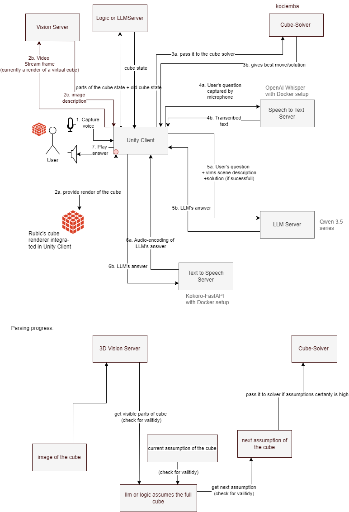

# VLM Assistant

A voice assistant for solving a Rubik's Cube, built in Unity. The assistant reads the state of a rendered cube from a picture,
computes a solution with a Kociemba solver, and tells the user in plain speech which face to turn next. All components run locally.

The assistant never receives the cube's internal state. It works only from what its face readers can see in the rendered image.

Forked from [stytim/agent-pipeline-minimal](https://github.com/stytim/agent-pipeline-minimal) (see [Credits](#credits)).

## Demo

https://github.com/user-attachments/assets/cd575943-a12d-40ea-9872-2a7dce0a827e
[**Watch the demo video**](docs/demo.mp4) (about 3 minutes, with sound): the assistant is asked for help by voice, reads the cube, and
speaks the next moves while the debug overlay, the on-screen console and the solution panel show what is happening. It was recorded
with the built-in recorder.

## Features

- **Voice interaction:** speech-to-text, an LLM/VLM, and text-to-speech, with echo cancellation for interruptions.
- **Two face readers:** a classical image-processing reader (no model) and a vision-language-model reader.
- **Robust state estimation:** rule checks on every read, per-face trust scores, move detection, and consistency repair.
- **Interactive cube:** layer turns by mouse or keyboard, with a 3D model, sounds and particles.
- **Developer tools:** debug overlay, on-screen console, reader benchmark, and a built-in screen and audio recorder.

## Architecture



The diagram shows the data flow between the Unity client and its services, and the lower part shows how the cube state is built
up: the visible parts of the cube are read from an image and checked for validity, completed to a full cube by the logic or LLM,
checked against the current assumption, and passed to the solver once the assumption is certain enough. In this implementation the
vision step is either the classical reader inside the Unity client or the VLM served by the same LLM server.

The scene's cube is a mirror image of a standard cube. The picture is flipped before reading, and the solver's moves are
converted back, so a letter alone always means "turn that face clockwise as seen on screen". Both are disabled when a real camera is used.

## Requirements

- Unity 6 (`6000.3.11f1`)
- Python 3 with `kociemba` for the solver server
- A [LlamaLib](https://github.com/stytim/LlamaLib) server with a Qwen 3.5 GGUF model and its matching `mmproj` file
- An STT server (RealtimeSTT or Parakeet) and a TTS service (Kokoro-FastAPI or ElevenLabs)
- Optional: ffmpeg for the recorder (`winget install Gyan.FFmpeg`)

| Service | Default address |
| --- | --- |
| LLM / VLM | `127.0.0.1:13333` |
| Solver | `127.0.0.1:8090` |
| STT | `ws://127.0.0.1:8011` |
| TTS (Kokoro) | `127.0.0.1:8880` |

## Quick start

**1. Solver**

```bash
pip install kociemba
python cube_solver_server.py
```

**2. LLM / VLM server.** Download a model and the `mmproj-F16.gguf` from the same Hugging Face repository, for example
[Qwen3.5-2B](https://huggingface.co/unsloth/Qwen3.5-2B-GGUF) or [Qwen3.5-0.8B](https://huggingface.co/unsloth/Qwen3.5-0.8B-GGUF).
The two files must belong together; give each projection file a distinct name. On Windows the CUDA runtime folder must be on `PATH`:

```bat
set PATH=LlamaLib-v2.0.5\runtimes\win-x64\native;%PATH%
LlamaLib-v2.0.5\servers\llamalib_win-x64_server.exe -m Qwen3.5-2B-Q4_K_M.gguf -mm mmproj-2B-F16.gguf -t -1 -np 1 -c 4096 -b 512 -ngl 99 -fa off --port 13333 --host 0.0.0.0
```

Other platforms use the matching binary in `servers/`. Lower `-ngl` if GPU memory runs out.

**3. STT and TTS.** Start an STT server ([RealtimeSTT](https://github.com/stytim/RealtimeSTT-docker) or
[Parakeet](https://github.com/stytim/parakeet-tdt-0.6b-v3-fastapi-websocket)) and a TTS service
([Kokoro-FastAPI](https://github.com/remsky/Kokoro-FastAPI), or an ElevenLabs key in `Assets/Resources/ElevenLabsConfiguration`).

**4. Unity.** Open `Assets/Scenes/Sample Scene.unity`, set the server addresses and the microphone on the STT, LLM and TTS handlers,
and press Play. The status indicators turn green once a server answers; connections are retried automatically.
Click **Start conversation** and say, for example, "How can I solve the cube?". Without a microphone, use **Debug Tools → Tools → Solve now**.

Prompts are plain text files in `Assets/StreamingAssets/Prompts/` and can be edited without recompiling.

## Usage

**Cube controls:** left drag turns a layer; right drag rotates the cube; keys `R L U D F B` turn a face (Shift for the opposite
direction); `Q W A S X Z` rotate the cube; `E` resets the view; `C` resets the cube.

**Debug Tools** (top right). On a small window, maximise the Game view with Shift+Space.

| Section | Contents |
| --- | --- |
| View | 2D overlay with the real and remembered state and trust scores; backdrop |
| Face reader | VLM or classical; VLM output format, colour words, LLM merge; move estimator; consistency repair |
| Speech | LLM writes all replies |
| Interaction | layer highlight, click marker, particles, turn sound |
| Record | screen and sound to MP4 (`DebugCaptures/recordings/`) |
| Tools | on-screen console, Solve now, test sound, benchmark |

**Benchmark** (Tools → Benchmark) scores a reader against the true cube using seeded scrambles and views. It offers single-picture runs,
a comparison of the four VLM answer formats, and a full-cube mode that assembles the state, validates it, solves it, and checks the
solution on the real cube. Results are written to `DebugCaptures/benchmark_*/`.

## Project structure

| Path | Contents |
| --- | --- |
| `Assets/Scripts/LLMHandler.cs` | assistant flow, readers, memory, solver, replies, connection handling |
| `Assets/Scripts/ClassicalCubeReader.cs` | image-processing face reader |
| `Assets/Scripts/CubeVlmMemory.cs`, `ReadChecks.cs` | face memory, move estimator, rule checks |
| `Assets/Scripts/CubeMoves.cs`, `CubeGroundTruth.cs`, `FaceletValidator.cs` | cube notation and validation |
| `Assets/Scripts/RubiksCube*.cs`, `CubeSolverClient.cs`, `MoveSpeech.cs` | cube game, solver client, spoken moves |
| `Assets/Scripts/CubeDebugOverlay.cs`, `DebugUi.cs`, `InGameConsole.cs` | debug UI |
| `Assets/Scripts/CubeBenchmark.cs`, `SessionRecorder.cs` | benchmark and recorder |
| `Assets/StreamingAssets/Prompts/` | prompts |
| `cube_solver_server.py` | solver server |

## Limitations

- A single face cannot be oriented; a neighbouring face must also be visible.
- A turn whose changed stickers are all out of view is only noticed once those faces are seen again.
- Small VLMs read faces unreliably; the classical reader is the dependable choice.
- The LLM server, Unity, STT and TTS often share one GPU; nearly full video memory causes stutter, especially when recording.

## Credits

Built on the agent pipeline framework by Tianyu Song ([stytim/agent-pipeline-minimal](https://github.com/stytim/agent-pipeline-minimal)),
[LlamaLib](https://github.com/stytim/LlamaLib), [LLM for Unity](https://github.com/undreamai/LLMUnity),
[libaec3](https://github.com/stytim/libaec3), [Silero VAD](https://github.com/snakers4/silero-vad) and
[kociemba](https://github.com/muodov/kociemba). Check the licences of these projects before redistributing.

<details>
<summary>Citation for the underlying framework</summary>

```bibtex
@ARTICLE{song2025Enhancing,
  author={Song, Tianyu and Pabst, Felix and Eck, Ulrich and Navab, Nassir},
  journal={IEEE Transactions on Visualization and Computer Graphics},
  title={Enhancing Patient Acceptance of Robotic Ultrasound through Conversational Virtual Agent and Immersive Visualizations},
  year={2025}, volume={31}, number={5}, pages={2901-2911}, doi={10.1109/TVCG.2025.3549181}}
```
```bibtex
@inproceedings{song2025intelligent,
  title={Intelligent Virtual Sonographer (IVS): Enhancing Physician-Robot-Patient Communication},
  author={Song, Tianyu and Li, Feng and Bi, Yuan and Karlas, Angelos and Yousefi, Amir and Branzan, Daniela and Jiang, Zhongliang and Eck, Ulrich and Navab, Nassir},
  booktitle={International Conference on Medical Image Computing and Computer-Assisted Intervention},
  pages={287--297}, year={2025}, organization={Springer}
}
```
</details>
